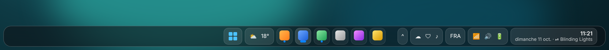

# Barre des tâches Windows 11 « façon lumabar » (Windhawk)

Ce dossier transforme la barre des tâches native de Windows 11 en un dock flottant
en verre, inspiré de [lumabar](https://lumabar.xyz) : barre détachée des bords de
l'écran, grands arrondis, chaque groupe (Démarrer, widgets, applis, zone système,
horloge) dans sa propre « tuile », point bleu sous les applis ouvertes, menus et
volets dans la même matière. Le mode sombre et le mode clair de Windows sont pris
en charge automatiquement.



Il ne s'agit pas d'une copie de lumabar (pas de widgets IA, revenus, Screen Time) :
c'est un habillage de la vraie barre des tâches, donc tout continue de fonctionner
comme d'habitude (épinglage, miniatures, zone de notification, Win+touches, etc.).

## Fichiers

| Fichier | Rôle |
| --- | --- |
| `lumabar-taskbar-styler.yaml` | Le thème, à importer dans le mod **Windows 11 Taskbar Styler** |
| `lumabar-clock-widget.yaml` | Config optionnelle du mod **Taskbar Clock Customization** : heure en haut, jour + date + titre en lecture en bas, stats système dans l'infobulle |
| `preview.png` | Maquette du rendu attendu (ce n'est pas une capture réelle) |

## Prérequis

- Windows 11 22H2 ou plus récent (barre des tâches XAML).
- [Windhawk](https://windhawk.net) installé.
- Mod **Windows 11 Taskbar Styler** (obligatoire) et, si vous voulez la tuile
  horloge enrichie, mod **Taskbar Clock Customization**.
- Réglages Windows recommandés (Paramètres > Personnalisation > Barre des tâches) :
  Recherche **Masquer**, Affichage des tâches **désactivé**, alignement **Centre**.
  Le bouton Widgets (météo) peut rester : il devient une tuile.

## Installation

1. Dans Windhawk, ouvrez le mod **Windows 11 Taskbar Styler**, onglet **Settings**.
2. Cliquez sur **Textual mode**.
3. Remplacez tout le contenu par celui de `lumabar-taskbar-styler.yaml`.
4. **Save settings**. La barre se redessine en quelques secondes.
5. (Optionnel) Même opération dans **Taskbar Clock Customization** avec
   `lumabar-clock-widget.yaml`.

Pour revenir en arrière : dans le Taskbar Styler, remettez `theme: ""` et videz
`controlStyles`, ou désactivez le mod.

> **Important :** le thème fixe lui-même la hauteur de la barre (`DockHeight`).
> N'utilisez pas en même temps le mod **Taskbar height and icon size**, sinon les
> deux se battent et le dock se recolle au bord de l'écran. Si vous tenez à ce mod,
> supprimez la cible `Taskbar.TaskbarFrame` / `Height=$DockHeight` du thème et
> alignez `DockHeight` sur la hauteur choisie dans le mod.

## Personnalisation

Tout se règle dans `styleConstants` en haut du fichier (ou, sans repasser en mode
texte, dans la section **Style constants** des réglages du mod).

| Constante | Défaut | Effet |
| --- | --- | --- |
| `DockHeight` | 58 | Hauteur totale réservée (dock + espace sous le dock) |
| `DockGapBottom` / `DockGapTop` / `DockGapSide` | 8 / 0 / 8 | Espace entre le dock et les bords de l'écran |
| `DockRadius` | 18 | Arrondi du dock |
| `TileRadius` | 11 | Arrondi des tuiles |
| `TileInset` / `TileGap` | 5 / 3 | Marge verticale des tuiles / espace entre tuiles |
| `DotOffset` | 7 | Hauteur du point « appli ouverte » |
| `DockBackground` | verre sombre 50 % | Matière du dock (`WindhawkBlur`) |
| `TileBackground` / `TileBorder` | blanc 10 % / 14 % | Fond et bordure des tuiles système |
| `AppTileBackground` / `AppTileBorder` | blanc 6 % / 10 % | Fond et bordure des tuiles d'applis (mettre `<SolidColorBrush Color="Transparent"/>` pour des icônes « nues ») |
| `HoverBackground` / `PressedBackground` / `ActiveBackground` | 20 % / 8 % / 15 % | États survol, clic, appli active |
| `Accent` | `#0A84FF` | Couleur du point « appli ouverte » |
| `FlyoutBackground` / `FlyoutRadius` | verre 72 % / 16 | Menus, infobulles, miniatures |

### Variantes lumabar

- **Glass** (défaut) : telles quelles.
- **Midnight** (noir opaque) : `DockBackground=<SolidColorBrush Color="#0A0A0C"/>`
  et `FlyoutBackground=<SolidColorBrush Color="#111114"/>`.
- **White** : passez Windows en mode clair (les couleurs suivent), puis si vous
  voulez du blanc franc : `DockBackground=<SolidColorBrush Color="#F7F7FA"/>`.
- **Barre en haut** (Windows 11 récent avec l'option de position) :
  `DockGapTop=8` et `DockGapBottom=0`.
- **Sans bouton Démarrer** (comme lumabar, Démarrer via la touche Windows) :
  retirez les `//` devant `Visibility=Collapsed` dans la section 2 du thème.
- **Dock « pilule » centré** au lieu de pleine largeur : ce thème est pleine
  largeur par conception. Pour une pilule, partez plutôt du thème intégré
  **LiquidGlass** du mod et reprenez les constantes de couleurs d'ici.

### Tuile horloge

`lumabar-clock-widget.yaml` affiche l'heure (`HH:mm`) sur la ligne du haut et
« jour date · ⏯ titre en lecture » sur la ligne du bas. Autres lignes du bas
possibles (motifs du mod) :

```yaml
BottomLine: '%weekday% %date%  ·  CPU %cpu%  RAM %ram%'
```

```yaml
BottomLine: '%weekday% %date%  ·  %weather%'
```

Pour la météo, renseignez `WebContentWeatherLocation` (ville ou code postal).

## Dépannage

- **Rien ne change** : redémarrez l'Explorateur (Gestionnaire des tâches > Explorateur
  Windows > Redémarrer). Vérifiez qu'aucun autre outil ne touche la barre
  (TranslucentTB, ExplorerPatcher, StartAllBack, Start11) : ils entrent en conflit
  avec le Taskbar Styler.
- **Petite tuile vide de quelques pixels dans la zone système** : vous n'avez
  aucune icône épinglée dans la zone de notification. Supprimez
  `SystemTray.NotificationAreaIcons#NotificationAreaIcons > ItemsPresenter > StackPanel`
  de la cible correspondante (section 5).
- **Point bleu trop haut / trop bas, tuiles rognées** : ajustez `DotOffset`,
  `TileInset` et `DockHeight`. Les valeurs par défaut visent 100 % d'échelle ; à
  125 % ou 150 % montez `DockHeight` (64 à 72) et `DockGapBottom` (10).
- **Barre verticale (gauche/droite)** : non prise en charge par ce thème.
- Pour inspecter les éléments et affiner un style : [UWPSpy](https://ramensoftware.com/uwpspy).

## Références

- Mod [Windows 11 Taskbar Styler](https://windhawk.net/mods/windows-11-taskbar-styler)
- [Guide de style de la barre Windows 11](https://github.com/ramensoftware/windows-11-taskbar-styling-guide)
  (les thèmes intégrés LiquidGlass, Pills et OS26 Liquid Glass ont servi de base aux cibles utilisées ici)
- Mod [Taskbar Clock Customization](https://windhawk.net/mods/taskbar-clock-customization)
- [lumabar](https://lumabar.xyz), l'inspiration
